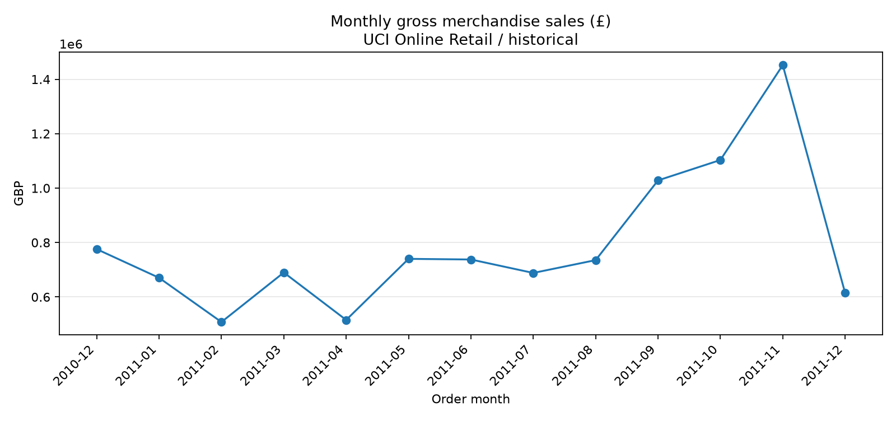
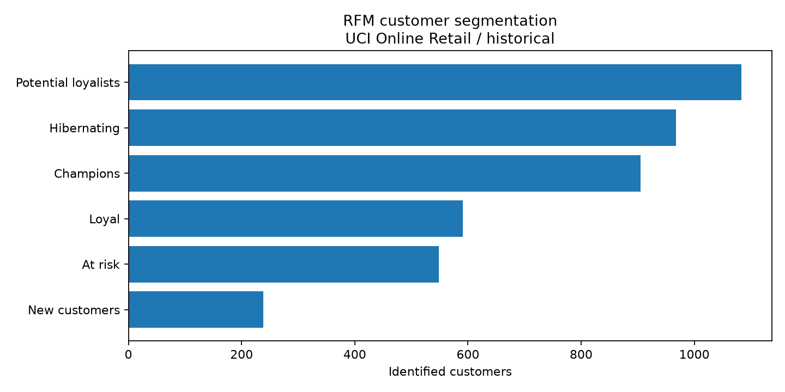
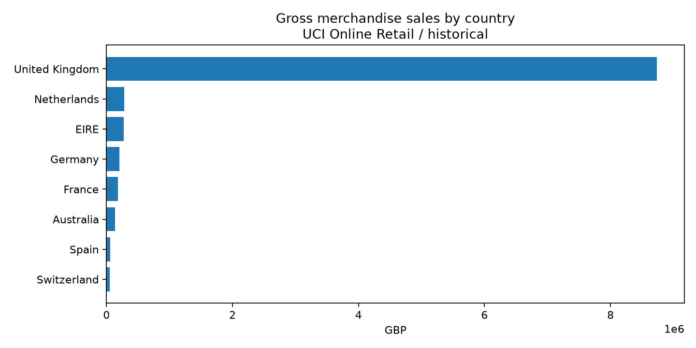

# Retail Sales & Customer Analytics

**SQL (SQLite) · Python/pandas · Power BI-ready data model · Customer segmentation**

An end-to-end **educational business analytics case** built around transactions from an online gift retailer. It answers four practical questions: *How are sales developing? Which products and markets matter? Who buys again? Which customers should retention teams prioritize?*

> **Data status:** this repository ships a **synthetic demo** for offline execution, prominently labelled in outputs. The business-facing real-data analysis is designed for the separate **UCI Online Retail** dataset (541,909 transaction lines, Dec 2010–Dec 2011). To produce observations about the real retailer, download the original UCI workbook and run `--mode real`. **Do not quote demo figures as real findings.**



## 1. Business questions and KPIs

| Area | Analysis | Why a business stakeholder cares |
|---|---|---|
| Sales | Gross positive merchandise sales, orders, AOV, monthly changes | Sales planning and tracking seasonality |
| Product / geography | Ranking of SKUs and countries by merchandise sales | Identify sales concentration and priorities |
| Customers | Repeat-buyer share, purchase cohort, RFM segmentation | Campaign targeting and reactivation hypotheses |
| Data quality | Missing buyer IDs, cancellations, charges and duplicates | Avoid misleading KPIs |

**Critical distinction:** gross positive merchandise sales are not net revenue, profit or margin. Cancellations are recorded separately; costs and marketing spend are not supplied.

## 2. Data provenance

- **Official source:** [UCI Machine Learning Repository — Online Retail (ID 352)](https://archive.ics.uci.edu/dataset/352/online+retail)
- **Citation:** Chen, D. (2015). *Online Retail*. UCI Machine Learning Repository. https://doi.org/10.24432/C5BW33
- **License:** source dataset **CC BY 4.0**. Code in this repo **MIT**.
- **Period:** December 1, 2010 to December 9, 2011 (first and last observation months are incomplete).
- **Rows:** 541,909 in official source; each row is a transaction **line item**, not an order.
- **Demo:** `data/demo/online_retail_demo.csv` is algorithmically generated, contains artificial customers and synthetic transactions. It is never used as evidence about the real business.

The full original UCI workbook is **not bundled** in this repo. Its original file can be retrieved by `scripts/download_uci.py`.

## 3. Reproduce the project

Python 3.10+ required. From the project root:

```bash
python -m venv .venv
# Windows: .venv\Scripts\activate
# macOS/Linux: source .venv/bin/activate
pip install -r requirements.txt

# Fast offline smoke test (SYNTHETIC DEMO)
python scripts/generate_demo.py
python scripts/run_pipeline.py --mode demo
python scripts/run_sql.py
python -m unittest discover -s tests -v

# To run on the REAL, original UCI workbook (requires internet)
python scripts/download_uci.py
python scripts/run_pipeline.py --mode real
python scripts/run_sql.py
```

You may also manually download `Online Retail.xlsx` from the UCI source page into `data/raw/Online Retail.xlsx` if the scripted request fails.

**Warning:** running the real pipeline replaces `data/processed/`, `database/retail_analysis.sqlite`, the charts and results with real-data output. This is intentional.

## 4. Tools and deliverables

```
retail-sales-customer-analytics/
├── data/
│   ├── demo/            # synthetic offline demo, explicitly labelled
│   ├── raw/             # UCI workbook downloaded by user, Git-ignored
│   └── processed/       # Power BI-ready CSV tables
├── database/            # SQLite analytical database
├── scripts/             # demo generator, UCI downloader, ETL, charting, SQL runner
├── sql/                 # KPI, cohort, RFM, cancellation and window-function queries
├── powerbi/             # step-by-step Power BI build guide and DAX measures
├── notebooks/           # student-readable walkthrough
├── figures/             # static chart previews labelled by data mode
├── reports/             # generated KPIs, QA table, SQL query outputs
├── docs/                # methodology, limitations and resume blurb
└── tests/               # data-cleaning and metric unit tests
```

### SQL examples

- `sql/01_kpis.sql` — sales, orders, AOV
- `sql/02_cohorts.sql` — **CTEs** and customer retention cohorts
- `sql/03_rfm.sql` — segment-level metrics
- `sql/04_top_products.sql` — product ranking
- `sql/05_returns_quality.sql` — cancellation-line metrics
- `sql/06_customer_rank.sql` — **ROW_NUMBER window function** for country-specific customer ranking

### Python / pandas

The cleaning pipeline validates types, identifies cancellation invoices, excludes non-merchandise charges and nonpositive entries, drops exact-row duplicates, builds invoice- and customer-grain data tables and saves a SQLite database for SQL queries.

### Power BI

Prepared CSVs, DAX measures and instructions are in [`powerbi/`](powerbi/README.md).

> **Power BI status:** a native `.pbix` dashboard is **not yet included**. Power BI Desktop is needed to assemble, validate and save the interactive report. The visual PNG previews are Python charts, not Power BI screenshots.

## 5. Selected metrics and visuals

### Synthetic DEMO (pipeline verification only)

The generated [`analysis_summary.md`](reports/analysis_summary.md) shows example gross merchandise sales, orders, AOV, identifiable buyers, repeat rate and data-quality counters. **These numbers are not observed UCI results.**

| Monthly sales preview | RFM segments | Country contribution |
|---|---|---|
|  |  |  |

## 6. Analytical boundaries

1. **Unknown customers:** an order without a customer ID contributes to sales KPIs, but cannot be used for customer retention/RFM.
2. **Returns:** invoice IDs starting with C show cancellations. Negative units × unit price is a **proxy**, not a reconciliation to real refunds. Gross sales exclude these records rather than netting them.
3. **No funnel/cost data:** do not infer conversion, acquisition costs, gross margin or profit.
4. **Historical/partial coverage:** source ends December 9, 2011; later months and post-extract behavior are not observable. Apparent recent customer churn can be right-censoring.
5. **Segmentation:** RFM groups are heuristic suggestions for targeting, not causal estimates of campaign uplift.

For full definitions see [methodology](docs/methodology.md).

## 7. Next portfolio milestone

1. Run the original **UCI** dataset and compare Python and SQL KPIs.
2. Build and commit an interactive `.pbix` report using the `powerbi/` guide.
3. Replace the demo screenshots at the top with verified charts from UCI real data and add 3–4 measured insights with limitations.
4. Link the finished project in Data Analyst / Product Analyst CV variants.

## Author

**Nikita Buribaev** · MiBA, Graduate School of Management, Saint Petersburg State University · [GitHub](https://github.com/Loliquidatorqq)